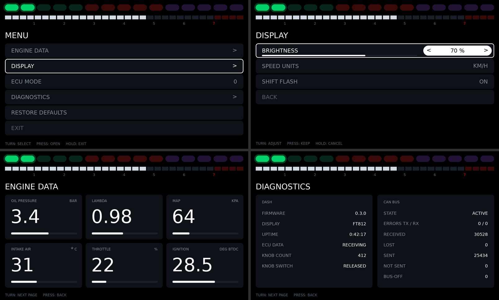

# MR2 Dashboard Firmware

Firmware for a custom STM32G0B1CBT6 board that drives a
[Newhaven NHD-7.0-800480FT-CSXP](https://newhavendisplay.com/) 7" 800×480 IPS
display and shows engine data from a [rusEFI](https://rusefi.com/) ECU
(uaEFI) over CAN. The display has an FT812 EVE graphics controller on board, so the MCU
sends compact display-list commands over SPI. The FT812 does the rendering;
there's no frame buffer on the MCU.


*Approximate previews, rendered on a PC from the firmware's real command stream
by `tools/render_preview.py`. The fonts are stand-ins for the EVE ROM fonts.
Top: cruising, everything normal. Middle: at the shift point, with both ECU
warning lamps on and an overheating engine, low fuel and low battery. Bottom: the boot splash with the
team logo, three start lights in.*

## What it does

1. Brings up the clock (64 MHz from a crystal or HSI16), SysTick, SPI1, the
   debug UART, the CAN controller (FDCAN1, 500 kbit/s) and the rotary knob
   (TIM3 in encoder mode).
2. Resets and initialises the FT812 using the timing from the NHD datasheet.
3. Shows a splash screen with the team logo, fades the backlight in, runs five
   F1-style start lights, and on "lights out" sweeps the rev bar to the stop
   and back.
4. Walks the driver through starting the engine, one screen per step (see
   [Pre-start guide](#pre-start-guide)), then runs the main screen at about
   60 fps (see [Screen](#screen)), all from the ECU's CAN broadcast.
5. Opens a menu when the knob is pressed: settings, more engine data and
   diagnostics (see [Menu](#menu)).
6. Sends a status frame back to the ECU 10 times a second (see
   [Dashboard → ECU](#dashboard--ecu)).

If the display stops responding (cable unplugged, co-processor fault), the
firmware logs it and re-initialises once a second. The CAN link keeps running
meanwhile. For bench work without an ECU, build with `-DMR2_DEMO_DATA=ON` to
show a built-in simulation instead (the screen then says "DEMO DATA").

## Screen

The layout borrows from F1 steering-wheel displays. Colour always means
something: while everything is normal the screen is monochrome apart from the
shift lights, and a value only turns blue, amber or red when it needs
attention.

| Element | What it shows |
|---|---|
| Shift lights | 15 LEDs across the top in green, red and purple groups. The first lights at 4500 rpm, one more about every 140 rpm, and at 6500 rpm all of them flash purple |
| Rev bar | 0–8000 rpm in 250 rpm segments, with the redline zone (7000+) tinted red |
| Gear | Centre box. Its frame takes the colour of the shift lights, and the whole box flashes purple at the shift point, so the cue is also in central vision. Neutral shows a green N |
| Speed, rpm | Either side of the gear. rpm turns red past the redline |
| Lamps | CHECK ENGINE (amber) under the speed and LIMITER (red) under the rpm, from the ECU, only while on |
| Alert | Appears under the gear only when something is wrong: the most severe message, plus a count of any others (`COOLANT HOT  +2`). Critical ones flash |
| Coolant, fuel, battery | Tiles along the bottom. Each bar has its danger zone tinted, and the tile shows a status word and accent colour only when the value is out of range |

Thresholds (all in `src/app/dashboard.c`):

| Value | Status | Alert |
|---|---|---|
| Coolant < 60 °C | `COLD`, blue | none: it's information, not a fault |
| Coolant > 100 °C | `HIGH`, amber | `COOLANT HIGH` |
| Coolant > 105 °C | `HOT`, red | `COOLANT HOT` (critical) |
| Fuel < 15 % | `LOW`, amber | `LOW FUEL` |
| Fuel < 5 % | `EMPTY`, red | `FUEL EMPTY` (critical) |
| Battery < 11.8 V | `LOW`, amber | `BATTERY LOW` |
| Battery > 15.0 V | `HIGH`, amber | `VOLTAGE HIGH` |
| Battery < 13.0 V with the engine running | `NO CHG`, amber | `NOT CHARGING` |

### Pre-start guide


Starting the engine takes three things, in order: turn off the e-stop, plug
in the steering wheel, press start. Until the engine runs, the screen shows
the first one not done yet. A stepper along the top shows progress (done steps
turn green), and each screen has an icon, the instruction, and the live state
of the input it is waiting for. The screens follow the inputs, so a step that
is undone again (e-stop pressed back in) brings its screen back.

The start button only works in neutral or with the clutch held, so the start
screen puts that rule in an amber-framed card with both conditions live:
each turns green with a tick when met (the neutral one also shows the gear
selected), and either one is enough. Below it the screen says `NOT READY`,
`READY TO START` (the button's ring turns green and pulses) or `CRANKING`.

The guide is for a parked car. It shows while rpm and speed say the engine
is off (below 400 rpm) and the car is stopped, and right after power-up
while the ECU hasn't said anything yet. If the engine stops or the ECU goes
quiet while the car is still rolling, the gauges stay up, so speed stays
visible.

The inputs are `estop_active`, `wheel_connected` and `clutch_held` in
`dash_data_t`, along with `gear` and `rpm` from the ECU. The ECU doesn't
broadcast the first three, so they count only once their `DASH_VALID_ESTOP`,
`DASH_VALID_WHEEL` and `DASH_VALID_CLUTCH` bits are set (see
[Notes](#notes-and-next-steps)). Until then the guide doesn't pretend: steps
it can't check are dimmed with a dash and skipped, the clutch shows `--`, and
with neither condition known to be met it gives no verdict.

**The neutral check is only as good as the ECU's gear.** Without gear
detection set up in rusEFI, the ECU reports neutral in every gear, and the
start screen will say `READY TO START` while in gear.

The demo (`-DMR2_DEMO_DATA=ON`) runs through the whole procedure after boot:
e-stop released at 3 s, wheel in at 6 s, first gear still selected so start
is blocked until the clutch goes down at 8.5 s, then cranking at 10 s and the
engine catching at 10.8 s.

### Menu



Press the knob (a Bourns PEC11L rotary encoder with a push switch) to open
the menu over the main screen or the pre-start guide. The shift lights and
rev bar stay at the top, and if anything needs attention, the alert from the
main screen shows next to the menu's title, flashing as usual.

| Knob | In a list | Changing a value | On a page |
|---|---|---|---|
| Turn | move the highlight | change it | next or previous page |
| Press | open, change, switch or run the item | keep the new value | back to the list |
| Hold (0.6 s) | up a level, or close the menu | cancel and put it back | back to the list |

Every list ends with a `BACK` row (`EXIT` at the top), and the bottom line
says what the knob does on the current screen. A list left alone for 10 s
closes by itself, so the menu never covers the gauges for long. If a
value is being changed at that point, it's dropped, except for brightness,
which keeps what it was turned to. Pages stay up until you leave them,
since they're there to be watched.

The demo items (`src/app/dash_menu.c`):

| Item | Type | What it does |
|---|---|---|
| ENGINE DATA | page | Oil pressure, lambda, MAP, intake air, throttle and ignition timing from the ECU, `--` for any it isn't sending or has no sensor for |
| DISPLAY › BRIGHTNESS | value, 10–100 % | Backlight. Changes while you turn, so you can see it |
| DISPLAY › SPEED UNITS | choice | KM/H or MPH on the main screen |
| DISPLAY › SHIFT FLASH | on/off | Off: the shift lights and gear box stay lit at the shift point instead of flashing |
| ECU MODE | value, 0–9 | Sent to the ECU in the status frame (byte 4). Only the value you keep goes out, not the ones you turn past on the way |
| DIAGNOSTICS | page | Firmware version, display chip, uptime, the knob's raw count and switch, ECU link, CAN state and counters |
| RESTORE DEFAULTS | action | All settings back to their defaults |

Settings live in RAM, so they're back to the defaults at every power-up.

**Adding to the menu.** The menu is a tree of `const` tables in flash, one
line per item, built with the macros in `src/app/menu.h`:

```c
static const menu_item_t k_display[] = {
    MENU_VALUE_ITEM("BRIGHTNESS", g_settings.brightness_pct, 10, 100, 10, "%", MENU_LIVE),
    MENU_CHOICE_ITEM("SPEED UNITS", g_settings.speed_units, k_speed_units, 0u),
    MENU_TOGGLE_ITEM("SHIFT FLASH", g_settings.shift_flash),
};
```

A new setting is a field in `settings_t` (`src/app/settings.h`), a line in
a table, and the code that reads it. Item types: `MENU_SUBMENU` (a nested
list, up to 4 deep), `MENU_PAGE` (a draw function for the area under the
title), `MENU_VALUE` (a number with range, step and unit), `MENU_CHOICE` (one
of a list of names), `MENU_TOGGLE` and `MENU_ACTION` (a function, which can
return a message to show, like `DEFAULTS RESTORED`). Values and choices are
written when kept; add `MENU_LIVE` to write them at every click instead, for
settings you want to see change.

### Team logo

The splash logo is stored as its outline, not as a bitmap: 34 corner points,
136 bytes of flash, and nothing loaded into the FT812's graphics RAM. The
FT812 fills it with a stencil-buffer polygon fill (`EDGE_STRIP_B` with
`INVERT`) inside the logo's box, then draws a 1 px line along the outline to
anti-alias the edges, so it stays sharp at any size. A 320 px wide bitmap
would take about 6 KB at 1 bit per pixel with jagged edges, or about 26 KB
anti-aliased at 4 bits per pixel.

To change the logo, trace the new artwork and paste the output into
`src/app/logo.c` and `logo.h` (needs Pillow and NumPy):

```sh
tools/trace_logo.py new-logo.png
```

The artwork has to be one light shape with straight edges and no holes; the
script says so if it isn't. It also reports how closely the outline matches the
artwork. The host tests check that the outline is a simple polygon that fills
the declared size.

## Hardware

| | |
|---|---|
| MCU | STM32G0B1CBT6: Cortex-M0+, 64 MHz, 128 KB flash, 144 KB RAM, LQFP48 |
| Display | NHD-7.0-800480FT-CSXP: FT812, 800×480, no touch panel |
| Display link | SPI mode 0. 8 MHz during init, 16 MHz after |
| ECU link | CAN 2.0, 500 kbit/s, via a 3.3 V transceiver (TJA1051T/3, SN65HVD230, MCP2562…) |
| Knob | Bourns PEC11L-4120K-S0020: 20 detents and 20 pulses per turn (4 edges per click), push switch |

### Default pin map

> **Check these against your schematic.** The board is custom, so these are
> sensible defaults, not a known layout. All of them live in
> [`src/board/board.h`](src/board/board.h); change them there.

| Display pin (CN1/CN2) | Signal | STM32 pin | Notes |
|---|---|---|---|
| 1 VDD | 3.3 V | — | ~100 mA |
| 2, 19, 20 GND | GND | — | |
| 3 SCK | SPI clock | **PA5** | SPI1_SCK, AF0 |
| 4 MISO/IO1 | SPI MISO | **PA6** | SPI1_MISO, AF0 |
| 5 MOSI/IO0 | SPI MOSI | **PA7** | SPI1_MOSI, AF0 |
| 6 /CS | chip select | **PA4** | GPIO |
| 7 /INT | interrupt | **PB1** | GPIO input with pull-up (not used yet) |
| 8 /PD | power down | **PB0** | GPIO. Must be driven: the firmware resets the FT812 with it |
| 9 AUDIO_L | audio PWM | — | needs the datasheet's filter and amplifier |
| 17, 18 VBL | backlight supply | — | 3.3 V at ~760 mA, or 5 V at ~440 mA |

Other defaults:

| Function | Pin | Setting |
|---|---|---|
| CAN TX → transceiver TXD | **PB9** (FDCAN1_TX, AF3) | `CAN_TX_*` |
| CAN RX ← transceiver RXD | **PB8** (FDCAN1_RX, AF3) | `CAN_RX_*`, pull-up |
| Knob A | **PB4** (TIM3_CH1, AF1) | `ENC_A_*`, pull-up |
| Knob B | **PB5** (TIM3_CH2, AF1) | `ENC_B_*`, pull-up |
| Knob switch (other pin to GND) | **PB3** | `ENC_SW_*`, GPIO input with pull-up |
| Transceiver S/STBY/Rs | PB7 | `BOARD_HAS_CAN_STBY`, **off by default**: tie the pin low on the board, or enable this |
| Crystal | PF0 / PF1 | `BOARD_HSE_HZ`, **0 (none) by default** |
| Debug UART TX | **PA2** (USART2, AF1) | `BOARD_HAS_DEBUG_UART`, 115200 8N1 |
| Status LED | PB2 | `BOARD_HAS_STATUS_LED`, **off by default** |
| SWD | PA13 / PA14 | untouched |

**CAN wiring.** CANH/CANL go to the ECU's CAN pins (on uaEFI, the CAN pair
on the main connector). A CAN bus needs a 120 Ω terminator at each end. The
ECU usually has one; fit the other at the dash if it's the far end.

**Knob wiring.** The encoder's common pin C and one side of its switch go
to GND. TIM3 counts every edge of A and B in hardware (encoder mode, through
its longest input filter), so no click is lost while a frame is drawn. A and
B must be CH1 and CH2 of one timer if you move them. The MCU's ~40 kΩ
pull-ups are on, which is enough on the bench; in the car, fit what Bourns
suggests on A and B: 10 kΩ pull-ups to 3.3 V, then 10 kΩ in series with
10 nF to GND at the MCU pin. If clockwise moves the highlight up instead of
down, set `ENC_REVERSE` in `board.h`. For an encoder with a different
number of pulses per click, set `ENCODER_COUNTS_PER_DETENT`
(`src/input/encoder.h`). Set `BOARD_HAS_ENCODER` to 0 for a board without
one.

**Fit a crystal.** With this firmware's CAN bit timing (81.25 % sample point,
SJW 3), the dash's clock can be at most about 1.4 % off from the ECU's.
HSI16 is ±1 % at best and drifts further at temperature extremes, so it works
on the bench but leaves little margin in a car. Fit a crystal (8 MHz is
typical) on PF0/PF1 and set `BOARD_HSE_HZ` in `board.h`. If it doesn't start,
the firmware falls back to HSI16 and says so at boot.

The backlight at full brightness draws a lot of current. Make sure the VBL
supply can deliver it, or turn the brightness down in the menu, or lower
`BACKLIGHT_DUTY` in `src/main.c` (0–128, the duty at 100 %) for bench
testing.

## Building

You need:

- the [Arm GNU toolchain](https://developer.arm.com/downloads/-/arm-gnu-toolchain-downloads)
  (`arm-none-eabi-gcc`, version 10 or later) on `PATH`. On Debian/Ubuntu:
  `sudo apt install gcc-arm-none-eabi libnewlib-arm-none-eabi`
- CMake 3.21 or later, and Ninja

```sh
cmake --preset release
cmake --build --preset release
# -> build/release/mr2-dashboard.{elf,hex,bin,map}
```

Use the `debug` preset (`build/debug/`) for an `-Og` build to step through.
Add `-DMR2_DEMO_DATA=ON` to the configure step to show simulated data instead
of the ECU's.
If the toolchain isn't on `PATH`, add `-DARM_TOOLCHAIN_DIR=/path/to/bin` to
the configure step. CMake 3.20 also works without presets:
`cmake -B build -G Ninja && cmake --build build`.

## Flashing

Any SWD probe works. For example:

```sh
# STM32CubeProgrammer
STM32_Programmer_CLI -c port=SWD -w build/release/mr2-dashboard.elf -v -rst

# OpenOCD with an ST-LINK. If OpenOCD was on PATH when you configured,
# this is also: cmake --build --preset release --target flash
openocd -f interface/stlink.cfg -f target/stm32g0x.cfg \
        -c "program build/release/mr2-dashboard.elf verify reset exit"
```

## Serial console

Connect a 3.3 V USB-UART to PA2 at 115200 8N1. `printf()` output goes there:

```
MR2 dashboard firmware 0.3.0
SYSCLK 64000000 Hz from crystal
CAN: 500 kbit/s, rusEFI broadcast at 0x200, dash status at 0x6D0
EVE: initialising
EVE: FT812 ready (chip id 0x00011208)
ECU: waiting for data at 0x200
ECU: receiving data
```

ECU link changes are logged as they happen, with the CAN error counters when
the data stops.

## ECU link (CAN)

The dash reads rusEFI's own CAN broadcast, "rusEFI CAN broadcast" in
TunerStudio (`can_verbose.cpp` in the rusEFI source, `rusEFI_CAN_verbose.dbc`
for CAN tools). uaEFI turns it on by default.

### ECU settings

In TunerStudio's CAN settings (uaEFI defaults shown):

| TunerStudio field | Value | Matching dash setting (`src/app/ecu_link.h`) |
|---|---|---|
| CAN read enabled, CAN write enabled | on | |
| Bitrate | 500 kbps | `ECU_CAN_BITRATE` |
| Enable rusEFI CAN broadcast | yes | |
| rusEFI CAN data bus | the bus the dash is wired to | |
| rusEFI CAN data base address | 512 (0x200) | `ECU_RUSEFI_BASE_ID` |
| rusEFI CAN data address type | 11 bit | `ECU_RUSEFI_EXT_ID` |
| rusEFI CAN data period | 50 ms | (`ECU_DATA_TIMEOUT_MS` must be well above this) |

For the gear indicator, set up gear detection on the ECU (gear count and
ratios, with a VSS). Without it rusEFI sends 0 and the dash shows N, which
also makes the pre-start guide's neutral check read as met.

### What's shown

```
ECU --CAN--> FDCAN1 --interrupt--> receive queue (64 frames, timestamped)
    --ecu_link_poll()--> rusefi_data_t --ecu_link_get_dash()--> dash_data_t --> screen
```

| Screen | rusEFI message | Signal |
|---|---|---|
| Shift lights, rev bar, rpm | base+1 | RPM |
| Speed | base+1 | VehicleSpeed |
| Gear | base+0 | CurrentGear |
| CHECK ENGINE lamp (only shown while on) | base+0 | CELAct |
| LIMITER lamp (only shown while on) | base+0 | RevLimAct: fuel or spark cut for any reason (rev limiter, launch control, limp mode…) |
| Coolant | base+3 | CoolantTemp |
| Fuel | base+3 | FuelLevel |
| Battery | base+4 | BattVolt |

All 12 broadcast messages are decoded (`src/app/rusefi_can.c`): MAP, IAT,
TPS/pedal, oil pressure and temperature, lambda, fuel pressure, trims, EGTs,
cams, knock and so on. Oil pressure, lambda, MAP, intake air, throttle and
ignition timing are on the menu's ENGINE DATA page, each with its own
`DASH_VALID_*` bit, so a sensor the ECU doesn't have shows `--`. All of them
are available through `ecu_link_data()` for other screens.

The ECU updates rpm 20 times a second and the screen redraws 60 times, so rpm
is low-pass filtered (`ECU_RPM_SMOOTH_MS`, 40 ms) to move smoothly.

**Stale data is never shown as live.** Each value expires 1 s
(`ECU_DATA_TIMEOUT_MS`) after its message last arrived. It's then drawn as
`--`, the shift lights and rev bar drop to 0, and the bottom-right corner says
why:

| Status line | Meaning |
|---|---|
| *(nothing)* | Receiving the ECU's broadcast |
| WAITING FOR ECU | Nothing received since power-up |
| NO DATA FROM ECU | The broadcast stopped |
| CAN BUS FAULT | The CAN controller is off the bus (it recovers by itself) or didn't start |
| DEMO DATA | Built with `MR2_DEMO_DATA` |


### Dashboard → ECU

The dash sends an 8-byte status frame on ID **0x6D0** (`DASH_TX_ID`) every
100 ms, and straight away when an input or the mode changes:

| Byte | Content |
|---|---|
| 0 | Counter, +1 per frame |
| 1 | Flags: bit 0 display running, bit 1 dash is receiving ECU data |
| 2–3 | Inputs, little-endian: bit *n* = input *n* active (`ecu_link_set_inputs()`) |
| 4 | Mode (`ecu_link_set_mode()`): the menu's ECU MODE, 0–9 |
| 5–7 | 0, reserved |

rusEFI hands frames like this to its Lua engine.
[`tools/rusefi/dash_link.lua`](tools/rusefi/dash_link.lua) is a ready-made ECU
script. It receives the frame, releases all inputs if the dash goes quiet for
0.5 s, and publishes inputs, mode and "dash alive" on Lua gauges 1–3 for
TunerStudio. Put your own actions in its `onDashInputs()`.

Nothing on the board drives the inputs yet. Wire buttons to spare GPIOs and
call `ecu_link_set_inputs()` from the main loop. Set `DASH_TX_ENABLE` to 0 for
a receive-only dash.

## Bring-up checklist

| Symptom | Things to check |
|---|---|
| `EVE: no response (REG_ID != 0x7C)` | 3.3 V on VDD; /PD wired and toggling; SCK/MOSI/MISO/CS on the right pins; MISO not swapped with MOSI; cable length (lower `EVE_SPI_PRESC_INIT` to `SPI_PRESC_DIV16`) |
| `ready`, but the screen stays dark | VBL supply present and strong enough; `BACKLIGHT_DUTY` > 0 |
| Backlight on, but no picture or noise | Panel timing in `src/eve/eve_panels.c`; try `cspread = 1` |
| Random `co-processor fault` / timeouts | Signal integrity at 16 MHz: try `EVE_SPI_PRESC_RUN = SPI_PRESC_DIV8`, shorten the cable, add a ground wire next to SCK |
| No UART output | `BOARD_HAS_DEBUG_UART`, TX pin, and baud rate. The firmware still runs without it |
| `WAITING FOR ECU` forever | ECU broadcast enabled, base address 0x200, 11-bit; same bit rate both ends; CANH/CANL not swapped; transceiver powered and its S/STBY pin low; TX/RX not swapped at the MCU |
| `NO DATA FROM ECU` with TEC/REC climbing in the log | Bit-rate or clock mismatch: fit a crystal (`BOARD_HSE_HZ`); check termination (about 60 Ω between CANH and CANL with the power off) |
| `CAN BUS FAULT` | Bus shorted, or the dash is alone on a bus at the wrong bit rate. It retries every 100 ms |
| Knob does nothing, or skips | Open MENU › DIAGNOSTICS (if a press opens the menu): KNOB COUNT should move by 4 per click, up for clockwise (else `ENC_REVERSE`), and KNOB SWITCH should follow the shaft. Check A/B on PB4/PB5 and C to GND; fit the RC filter if clicks are missed or doubled |

## Tests and preview

The EVE driver, the CAN pipeline, the renderer, the knob, the menus and the
simulation are covered by host tests that run on a PC against a simulated
FT812, a mock CAN driver and a mock encoder. The FT812 simulation decodes the SPI frames the way the chip does.
The tests check:

- the power-up sequence and its timing
- SPI framing
- the register values from the datasheet
- command-FIFO chunking and fault recovery
- every rendered frame: well-formed, on-screen, and small enough for the 8 KB display list
- which alerts, lamps and status words the dashboard shows, and their priority and flashing
- the logo outline (a simple polygon of the declared size) and its stencil fill
- the pre-start guide: which step shows, the neutral-or-clutch rule and its
  live state, what it does with inputs it can't see, and that the demo's start
  procedure runs in order and only cranks when the rule allows it
- the rusEFI decoder, against frames built from the signal definitions in
  rusEFI's DBC file (not from the decoder's own byte offsets)
- the pipeline: value mapping, expiry, link states, frames queued past their
  timeout, rpm smoothing
- the dash status frame: layout, timing, behaviour when nobody acknowledges it
- the receive queue across index wrap-around
- the knob: whole clicks only (bounce and wobble at a detent never count),
  fast spins and counter wrap-around, the switch's debouncing, press versus
  hold, and a press already held at start-up
- the menu engine, against a test menu with every item type: navigation and
  its limits, nesting depth, editing with keep, cancel and live values,
  toggles and actions, paging, scrolling, the timeout, and every screen it
  draws
- the dashboard's menu: each demo item changes its setting, ECU MODE only
  once kept, the main screen follows the speed units and shift flash, and
  the engine data and diagnostics pages show what they should

`tools/rusefi/dash_link.lua` can be checked with Lua 5.4 (`luac5.4 -p`).

```sh
cmake -S tests -B build-tests -G Ninja
cmake --build build-tests
ctest --test-dir build-tests --output-on-failure
```

To preview screen changes without hardware (needs Python 3 and Pillow):

```sh
./build-tests/preview_dump build-tests
tools/render_preview.py build-tests/*.bin   # -> build-tests/*.png
```

CI (`.github/workflows/ci.yml`) builds both firmware configurations with
`-Werror` and runs the host tests.

## Project layout

```
src/
  main.c                boot sequence and main loop
  board/                STM32G0B1 support: pins (board.h), clock, GPIO, SysTick, SPI, UART, syscalls
  eve/
    ft81x.h             FT81x registers and commands (names as in the Programmers Guide)
    eve.c/.h            EVE driver: init, memory access, command FIFO, widgets
    eve_hal.h           hardware interface the driver needs (SPI, CS, /PD, time)
    eve_hal_stm32.c     ... implemented for this board
    eve_panels.c        display timing for the NHD-7.0-800480FT-CSXP
  can/
    can.h               CAN driver interface (frames, filters, stats)
    can_queue.h         interrupt -> main loop frame queue
    can_stm32.c         FDCAN driver: filters, receive interrupt, TX FIFO, bus-off recovery
  input/
    encoder.h           rotary encoder interface (edge count, switch level)
    encoder_stm32.c     ... on TIM3 in encoder mode, switch on a GPIO
  app/
    dashboard.c         main screen and splash, and which screen to show
    guide.c             pre-start guide screens
    knob.c/.h           encoder count and switch -> clicks, presses and holds
    menu.c/.h           menu engine: item tables, navigation, editing, drawing
    dash_menu.c         the dashboard's menu and its items
    pages.c             menu pages: engine data, diagnostics
    settings.c/.h       the driver's settings, edited in the menu
    ui.c/.h             shared palette, fonts and drawing helpers
    dash_data.h         what the screen shows, with validity and link state
    ecu_link.c/.h       CAN pipeline: ECU data -> dash values, dash status -> ECU; its settings
    rusefi_can.c/.h     rusEFI broadcast decoder (all 12 messages)
    demo_data.c         simulated engine data, including the start procedure
    fixmath.c           integer sin/cos for the gauge geometry
    logo.c              team logo outline and its polygon fill
linker/                 STM32G0B1CBTx linker script
third_party/            CMSIS core 5.9.0 and ST cmsis_device_g0 v1.4.5 (Apache-2.0)
tests/                  host tests, mock FT812, mock CAN driver, mock encoder, preview dumper
tools/render_preview.py approximate PNG renderer for command streams
tools/trace_logo.py     turns logo artwork into the outline table in logo.c
tools/rusefi/           ECU-side Lua script for the dash status frame
```

## Notes and next steps

- **Start inputs.** The e-stop, steering-wheel detect and clutch switch are
  plain on/off signals that the ECU doesn't broadcast. Read them on spare
  GPIOs (or from another CAN node), fill in `estop_active`, `wheel_connected`
  and `clutch_held`, and set their `DASH_VALID_*` bits; the pre-start guide
  then checks them.
- **More from the ECU.** Everything rusEFI broadcasts is decoded already
  (`ecu_link_data()`). The ENGINE DATA page shows six values without
  thresholds; warnings for low oil pressure or a lean mixture would need
  limits that suit the engine.
- **Dash inputs.** The status frame carries 16 inputs and a mode byte to the
  ECU. The menu sets the mode; no buttons drive the inputs yet.
- **Saving settings.** The menu's settings are lost at power-off. Keeping
  them needs a flash page (the STM32G0 programs flash 64 bits at a time) and
  a version number on the stored settings.
- **Throughput.** The SPI driver is polled. A frame is under 2 KB, roughly
  1 ms at 16 MHz, so DMA is a later optimisation and not needed yet.
- **Not used yet.** Touch (this module has no panel fitted, so the touch
  engine is switched off), audio (AUDIO_L needs the datasheet's filter and
  amplifier circuit), /INT, the EVE GPIOs, and dual/quad SPI.
- **References.** The FT81x Series Programmers Guide documents every register
  and command in `ft81x.h`. The NHD datasheet gives the panel timing and the
  backlight PWM range (800 Hz–10 kHz).
