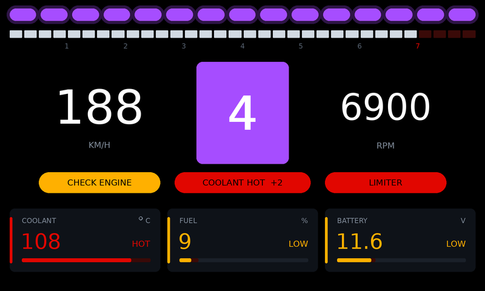
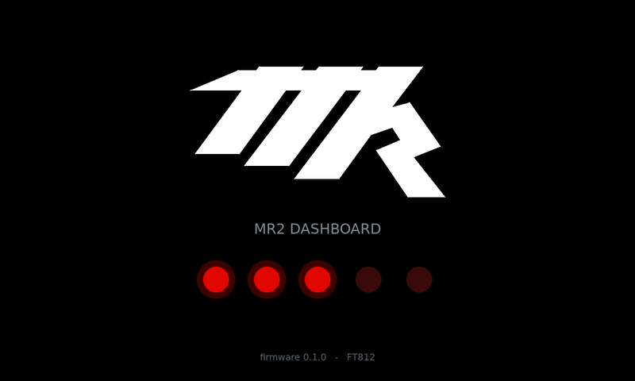
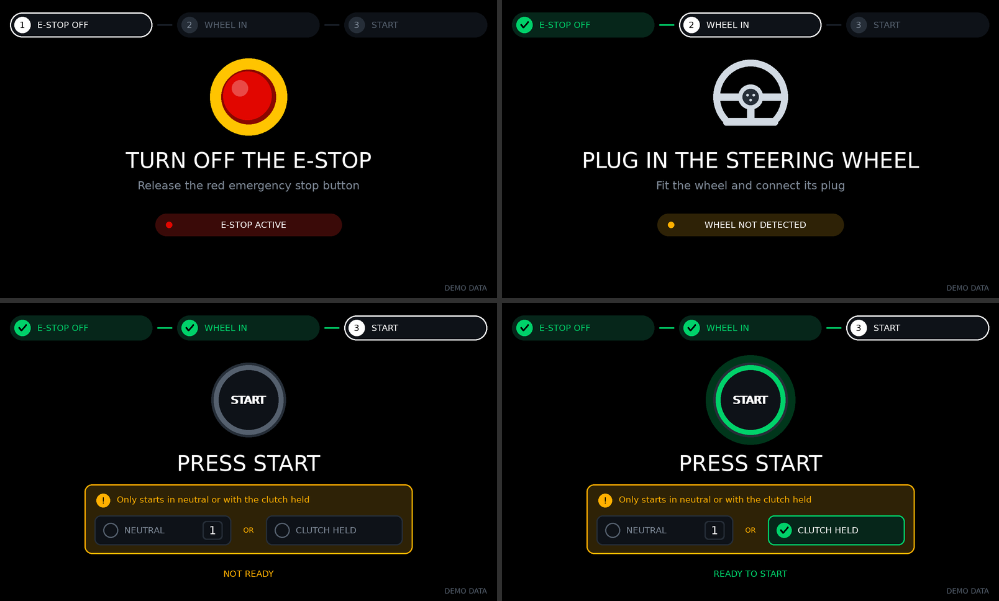

# MR2 Dashboard Firmware

Firmware for a custom STM32G0B1CBT6 board that drives a
[Newhaven NHD-7.0-800480FT-CSXP](https://newhavendisplay.com/) 7" 800×480 IPS
display. The display has an FT812 EVE graphics controller on board, so the MCU
sends compact display-list commands over SPI. The FT812 does the rendering;
there's no frame buffer on the MCU.






*Approximate previews, rendered on a PC from the firmware's real command stream
by `tools/render_preview.py`. The fonts are stand-ins for the EVE ROM fonts.
Top: cruising, everything normal. Middle: at the shift point, with an
overheating engine, low fuel and low battery. Bottom: the boot splash with the
team logo, three start lights in.*

## What it does

1. Brings up the clock (64 MHz from HSI16), SysTick, SPI1 and a debug UART.
2. Resets and initialises the FT812 using the timing from the NHD datasheet.
3. Shows a splash screen with the team logo, fades the backlight in, runs five
   F1-style start lights, and on "lights out" sweeps the rev bar to the stop
   and back.
4. Walks the driver through starting the engine, one screen per step (see
   [Pre-start guide](#pre-start-guide)), then runs the main screen at about
   60 fps (see [Screen](#screen)).

The values come from a built-in simulation (`src/app/demo_data.c`) until real
inputs are connected, and the screen shows "DEMO DATA" while it runs. If the
display stops responding (cable unplugged, co-processor fault), the firmware
logs it and re-initialises once a second.

## Screen

The layout borrows from F1 steering-wheel displays. Colour always means
something: while everything is normal the screen is monochrome apart from the
shift lights, and a value only turns blue, amber or red when it needs
attention.

| Element | What it shows |
|---|---|
| Shift lights | 15 LEDs across the top in green, red and purple groups. The first lights at 4500 rpm, one more about every 140 rpm, and at 6500 rpm all of them flash purple |
| Rev bar | 0–8000 rpm in 250 rpm segments, with the redline zone (7000+) tinted red |
| Gear | Centre box. Its frame takes the colour of the shift lights, and the whole box flashes purple at the shift point, so the cue is also in central vision. Neutral shows a green N |
| Speed, rpm | Either side of the gear. rpm turns red past the redline |
| Alert | Appears under the gear only when something is wrong: the most severe message, plus a count of any others (`COOLANT HOT  +2`). Critical ones flash |
| Coolant, fuel, battery | Tiles along the bottom. Each bar has its danger zone tinted, and the tile shows a status word and accent colour only when the value is out of range |

Thresholds (all in `src/app/dashboard.c`):

| Value | Status | Alert |
|---|---|---|
| Coolant < 60 °C | `COLD`, blue | none: it's information, not a fault |
| Coolant > 100 °C | `HIGH`, amber | `COOLANT HIGH` |
| Coolant > 105 °C | `HOT`, red | `COOLANT HOT` (critical) |
| Fuel < 15 % | `LOW`, amber | `LOW FUEL` |
| Fuel < 5 % | `EMPTY`, red | `FUEL EMPTY` (critical) |
| Battery < 11.8 V | `LOW`, amber | `BATTERY LOW` |
| Battery > 15.0 V | `HIGH`, amber | `VOLTAGE HIGH` |
| Battery < 13.0 V with the engine running | `NO CHG`, amber | `NOT CHARGING` |

### Pre-start guide



Starting the engine takes three things, in order: turn off the e-stop, plug
in the steering wheel, press start. Until the engine runs, the screen shows
the first one not done yet. A stepper along the top shows progress (done steps
turn green), and each screen has an icon, the instruction, and the live state
of the input it is waiting for. The screens follow the inputs, so a step that
is undone again (e-stop pressed back in) brings its screen back.

The start button only works in neutral or with the clutch held, so the start
screen puts that rule in an amber-framed card with both conditions live:
each turns green with a tick when met (the neutral one also shows the gear
selected), and either one is enough. Below it the screen says `NOT READY`,
`READY TO START` (the button's ring turns green and pulses) or `CRANKING`.

The guide shows whenever the engine isn't running (below 400 rpm) and the
car is stationary. If the engine stops while the car is still rolling, the
gauges stay up, so speed stays visible, until the car stops.

The inputs are `estop_active`, `wheel_connected` and `clutch_held` in
`dash_data_t`, along with `gear` and `rpm`. The demo runs through the whole
procedure after boot: e-stop released at 3 s, wheel in at 6 s, first gear
still selected so start is blocked until the clutch goes down at 8.5 s, then
cranking at 10 s and the engine catching at 10.8 s.

### Team logo

The splash logo is stored as its outline, not as a bitmap: 34 corner points,
136 bytes of flash, and nothing loaded into the FT812's graphics RAM. The
FT812 fills it with a stencil-buffer polygon fill (`EDGE_STRIP_B` with
`INVERT`) inside the logo's box, then draws a 1 px line along the outline to
anti-alias the edges, so it stays sharp at any size. A 320 px wide bitmap
would take about 6 KB at 1 bit per pixel with jagged edges, or about 26 KB
anti-aliased at 4 bits per pixel.

To change the logo, trace the new artwork and paste the output into
`src/app/logo.c` and `logo.h` (needs Pillow and NumPy):

```sh
tools/trace_logo.py new-logo.png
```

The artwork has to be one light shape with straight edges and no holes; the
script says so if it isn't. It also reports how closely the outline matches the
artwork. The host tests check that the outline is a simple polygon that fills
the declared size.

## Hardware

| | |
|---|---|
| MCU | STM32G0B1CBT6: Cortex-M0+, 64 MHz, 128 KB flash, 144 KB RAM, LQFP48 |
| Display | NHD-7.0-800480FT-CSXP: FT812, 800×480, no touch panel |
| Display link | SPI mode 0. 8 MHz during init, 16 MHz after |

### Default pin map

> **Check these against your schematic.** The board is custom, so these are
> sensible defaults, not a known layout. All of them live in
> [`src/board/board.h`](src/board/board.h); change them there.

| Display pin (CN1/CN2) | Signal | STM32 pin | Notes |
|---|---|---|---|
| 1 VDD | 3.3 V | — | ~100 mA |
| 2, 19, 20 GND | GND | — | |
| 3 SCK | SPI clock | **PA5** | SPI1_SCK, AF0 |
| 4 MISO/IO1 | SPI MISO | **PA6** | SPI1_MISO, AF0 |
| 5 MOSI/IO0 | SPI MOSI | **PA7** | SPI1_MOSI, AF0 |
| 6 /CS | chip select | **PA4** | GPIO |
| 7 /INT | interrupt | **PB1** | GPIO input with pull-up (not used yet) |
| 8 /PD | power down | **PB0** | GPIO. Must be driven: the firmware resets the FT812 with it |
| 9 AUDIO_L | audio PWM | — | needs the datasheet's filter and amplifier |
| 17, 18 VBL | backlight supply | — | 3.3 V at ~760 mA, or 5 V at ~440 mA |

Other defaults:

| Function | Pin | Setting |
|---|---|---|
| Debug UART TX | **PA2** (USART2, AF1) | `BOARD_HAS_DEBUG_UART`, 115200 8N1 |
| Status LED | PB2 | `BOARD_HAS_STATUS_LED`, **off by default** |
| SWD | PA13 / PA14 | untouched |

The backlight at full brightness draws a lot of current. Make sure the VBL
supply can deliver it, or lower `BACKLIGHT_DUTY` in `src/main.c` (0–128) for
bench testing.

## Building

You need:

- the [Arm GNU toolchain](https://developer.arm.com/downloads/-/arm-gnu-toolchain-downloads)
  (`arm-none-eabi-gcc`, version 10 or later) on `PATH`. On Debian/Ubuntu:
  `sudo apt install gcc-arm-none-eabi libnewlib-arm-none-eabi`
- CMake 3.21 or later, and Ninja

```sh
cmake --preset release
cmake --build --preset release
# -> build/release/mr2-dashboard.{elf,hex,bin,map}
```

Use the `debug` preset (`build/debug/`) for an `-Og` build to step through.
If the toolchain isn't on `PATH`, add `-DARM_TOOLCHAIN_DIR=/path/to/bin` to
the configure step. CMake 3.20 also works without presets:
`cmake -B build -G Ninja && cmake --build build`.

## Flashing

Any SWD probe works. For example:

```sh
# STM32CubeProgrammer
STM32_Programmer_CLI -c port=SWD -w build/release/mr2-dashboard.elf -v -rst

# OpenOCD with an ST-LINK. If OpenOCD was on PATH when you configured,
# this is also: cmake --build --preset release --target flash
openocd -f interface/stlink.cfg -f target/stm32g0x.cfg \
        -c "program build/release/mr2-dashboard.elf verify reset exit"
```

## Serial console

Connect a 3.3 V USB-UART to PA2 at 115200 8N1. `printf()` output goes there:

```
MR2 dashboard firmware 0.1.0
SYSCLK 64000000 Hz
EVE: initialising
EVE: FT812 ready (chip id 0x00011208)
```

## Bring-up checklist

| Symptom | Things to check |
|---|---|
| `EVE: no response (REG_ID != 0x7C)` | 3.3 V on VDD; /PD wired and toggling; SCK/MOSI/MISO/CS on the right pins; MISO not swapped with MOSI; cable length (lower `EVE_SPI_PRESC_INIT` to `SPI_PRESC_DIV16`) |
| `ready`, but the screen stays dark | VBL supply present and strong enough; `BACKLIGHT_DUTY` > 0 |
| Backlight on, but no picture or noise | Panel timing in `src/eve/eve_panels.c`; try `cspread = 1` |
| Random `co-processor fault` / timeouts | Signal integrity at 16 MHz: try `EVE_SPI_PRESC_RUN = SPI_PRESC_DIV8`, shorten the cable, add a ground wire next to SCK |
| No UART output | `BOARD_HAS_DEBUG_UART`, TX pin, and baud rate. The firmware still runs without it |

## Tests and preview

The EVE driver, renderer and simulation are covered by host tests that run on
a PC against a simulated FT812. The simulation decodes the SPI frames the way
the chip does. The tests check:

- the power-up sequence and its timing
- SPI framing
- the register values from the datasheet
- command-FIFO chunking and fault recovery
- every rendered frame: well-formed, on-screen, and small enough for the 8 KB display list
- which alerts and status words the dashboard shows, and their priority and flashing
- the logo outline (a simple polygon of the declared size) and its stencil fill
- the pre-start guide: which step shows, the neutral-or-clutch rule and its
  live state, and that the demo's start procedure runs in order and only
  cranks when the rule allows it

```sh
cmake -S tests -B build-tests -G Ninja
cmake --build build-tests
ctest --test-dir build-tests --output-on-failure
```

To preview screen changes without hardware (needs Python 3 and Pillow):

```sh
./build-tests/preview_dump build-tests
tools/render_preview.py build-tests/*.bin   # -> build-tests/*.png
```

CI (`.github/workflows/ci.yml`) builds both firmware configurations with
`-Werror` and runs the host tests.

## Project layout

```
src/
  main.c                boot sequence and main loop
  board/                STM32G0B1 support: pins (board.h), clock, GPIO, SysTick, SPI, UART, syscalls
  eve/
    ft81x.h             FT81x registers and commands (names as in the Programmers Guide)
    eve.c/.h            EVE driver: init, memory access, command FIFO, widgets
    eve_hal.h           hardware interface the driver needs (SPI, CS, /PD, time)
    eve_hal_stm32.c     ... implemented for this board
    eve_panels.c        display timing for the NHD-7.0-800480FT-CSXP
  app/
    dashboard.c         main screen and splash, and which screen to show
    guide.c             pre-start guide screens
    ui.c/.h             shared palette, fonts and drawing helpers
    demo_data.c         simulated engine data, including the start procedure
    fixmath.c           integer sin/cos for the gauge geometry
    logo.c              team logo outline and its polygon fill
linker/                 STM32G0B1CBTx linker script
third_party/            CMSIS core 5.9.0 and ST cmsis_device_g0 v1.4.5 (Apache-2.0)
tests/                  host tests, mock FT812, preview dumper
tools/render_preview.py approximate PNG renderer for command streams
tools/trace_logo.py     turns logo artwork into the outline table in logo.c
```

## Notes and next steps

- **Real inputs.** Replace `demo_data_update()` with real sources. The G0B1 has
  two FDCAN controllers, ADCs and timers for pulse inputs. CAN needs an
  accurate clock: fit an HSE crystal and switch `clock_init()` to it, because
  HSI16 (±1 %) is too loose. The e-stop, steering-wheel detect and clutch
  switch are plain on/off signals, so spare GPIOs (or a CAN message from
  whatever already reads them) will do.
- **Throughput.** The SPI driver is polled. A frame is under 2 KB, roughly
  1 ms at 16 MHz, so DMA is a later optimisation and not needed yet.
- **Not used yet.** Touch (this module has no panel fitted, so the touch
  engine is switched off), audio (AUDIO_L needs the datasheet's filter and
  amplifier circuit), /INT, the EVE GPIOs, and dual/quad SPI.
- **References.** The FT81x Series Programmers Guide documents every register
  and command in `ft81x.h`. The NHD datasheet gives the panel timing and the
  backlight PWM range (800 Hz–10 kHz).
