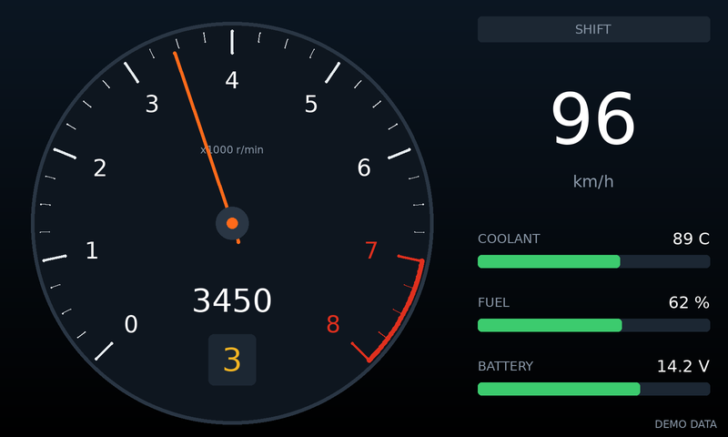

# MR2 Dashboard Firmware

Firmware for a custom STM32G0B1CBT6 board that drives a
[Newhaven NHD-7.0-800480FT-CSXP](https://newhavendisplay.com/) 7" 800×480 IPS
display. The display has an FT812 EVE graphics controller on board, so the MCU
sends compact display-list commands over SPI. The FT812 does the rendering;
there's no frame buffer on the MCU.



*Approximate preview, rendered on a PC from the firmware's real command stream
by `tools/render_preview.py`. The fonts are stand-ins for the EVE ROM fonts.*

## What it does

1. Brings up the clock (64 MHz from HSI16), SysTick, SPI1 and a debug UART.
2. Resets and initialises the FT812 using the timing from the NHD datasheet.
3. Shows a splash screen, fades the backlight in and sweeps the tach needle.
4. Runs the gauge screen at about 60 fps: a tachometer with redline, a shift
   light, speed, gear, and coolant/fuel/battery bars.

The values come from a built-in simulation (`src/app/demo_data.c`) until real
inputs are connected, and the screen shows "DEMO DATA" while it runs. If the
display stops responding (cable unplugged, co-processor fault), the firmware
logs it and re-initialises once a second.

## Hardware

| | |
|---|---|
| MCU | STM32G0B1CBT6: Cortex-M0+, 64 MHz, 128 KB flash, 144 KB RAM, LQFP48 |
| Display | NHD-7.0-800480FT-CSXP: FT812, 800×480, no touch panel |
| Display link | SPI mode 0. 8 MHz during init, 16 MHz after |

### Default pin map

> **Check these against your schematic.** The board is custom, so these are
> sensible defaults, not a known layout. All of them live in
> [`src/board/board.h`](src/board/board.h); change them there.

| Display pin (CN1/CN2) | Signal | STM32 pin | Notes |
|---|---|---|---|
| 1 VDD | 3.3 V | — | ~100 mA |
| 2, 19, 20 GND | GND | — | |
| 3 SCK | SPI clock | **PA5** | SPI1_SCK, AF0 |
| 4 MISO/IO1 | SPI MISO | **PA6** | SPI1_MISO, AF0 |
| 5 MOSI/IO0 | SPI MOSI | **PA7** | SPI1_MOSI, AF0 |
| 6 /CS | chip select | **PA4** | GPIO |
| 7 /INT | interrupt | **PB1** | GPIO input with pull-up (not used yet) |
| 8 /PD | power down | **PB0** | GPIO. Must be driven: the firmware resets the FT812 with it |
| 9 AUDIO_L | audio PWM | — | needs the datasheet's filter and amplifier |
| 17, 18 VBL | backlight supply | — | 3.3 V at ~760 mA, or 5 V at ~440 mA |

Other defaults:

| Function | Pin | Setting |
|---|---|---|
| Debug UART TX | **PA2** (USART2, AF1) | `BOARD_HAS_DEBUG_UART`, 115200 8N1 |
| Status LED | PB2 | `BOARD_HAS_STATUS_LED`, **off by default** |
| SWD | PA13 / PA14 | untouched |

The backlight at full brightness draws a lot of current. Make sure the VBL
supply can deliver it, or lower `BACKLIGHT_DUTY` in `src/main.c` (0–128) for
bench testing.

## Building

You need:

- the [Arm GNU toolchain](https://developer.arm.com/downloads/-/arm-gnu-toolchain-downloads)
  (`arm-none-eabi-gcc`, version 10 or later) on `PATH`. On Debian/Ubuntu:
  `sudo apt install gcc-arm-none-eabi libnewlib-arm-none-eabi`
- CMake 3.21 or later, and Ninja

```sh
cmake --preset release
cmake --build --preset release
# -> build/release/mr2-dashboard.{elf,hex,bin,map}
```

Use the `debug` preset (`build/debug/`) for an `-Og` build to step through.
If the toolchain isn't on `PATH`, add `-DARM_TOOLCHAIN_DIR=/path/to/bin` to
the configure step. CMake 3.20 also works without presets:
`cmake -B build -G Ninja && cmake --build build`.

## Flashing

Any SWD probe works. For example:

```sh
# STM32CubeProgrammer
STM32_Programmer_CLI -c port=SWD -w build/release/mr2-dashboard.elf -v -rst

# OpenOCD with an ST-LINK. If OpenOCD was on PATH when you configured,
# this is also: cmake --build --preset release --target flash
openocd -f interface/stlink.cfg -f target/stm32g0x.cfg \
        -c "program build/release/mr2-dashboard.elf verify reset exit"
```

## Serial console

Connect a 3.3 V USB-UART to PA2 at 115200 8N1. `printf()` output goes there:

```
MR2 dashboard firmware 0.1.0
SYSCLK 64000000 Hz
EVE: initialising
EVE: FT812 ready (chip id 0x00011208)
```

## Bring-up checklist

| Symptom | Things to check |
|---|---|
| `EVE: no response (REG_ID != 0x7C)` | 3.3 V on VDD; /PD wired and toggling; SCK/MOSI/MISO/CS on the right pins; MISO not swapped with MOSI; cable length (lower `EVE_SPI_PRESC_INIT` to `SPI_PRESC_DIV16`) |
| `ready`, but the screen stays dark | VBL supply present and strong enough; `BACKLIGHT_DUTY` > 0 |
| Backlight on, but no picture or noise | Panel timing in `src/eve/eve_panels.c`; try `cspread = 1` |
| Random `co-processor fault` / timeouts | Signal integrity at 16 MHz: try `EVE_SPI_PRESC_RUN = SPI_PRESC_DIV8`, shorten the cable, add a ground wire next to SCK |
| No UART output | `BOARD_HAS_DEBUG_UART`, TX pin, and baud rate. The firmware still runs without it |

## Tests and preview

The EVE driver, renderer and simulation are covered by host tests that run on
a PC against a simulated FT812. The simulation decodes the SPI frames the way
the chip does. The tests check:

- the power-up sequence and its timing
- SPI framing
- the register values from the datasheet
- command-FIFO chunking and fault recovery
- every rendered frame: well-formed, on-screen, and small enough for the 8 KB display list

```sh
cmake -S tests -B build-tests -G Ninja
cmake --build build-tests
ctest --test-dir build-tests --output-on-failure
```

To preview screen changes without hardware (needs Python 3 and Pillow):

```sh
./build-tests/preview_dump build-tests
tools/render_preview.py build-tests/*.bin   # -> build-tests/*.png
```

CI (`.github/workflows/ci.yml`) builds both firmware configurations with
`-Werror` and runs the host tests.

## Project layout

```
src/
  main.c                boot sequence and main loop
  board/                STM32G0B1 support: pins (board.h), clock, GPIO, SysTick, SPI, UART, syscalls
  eve/
    ft81x.h             FT81x registers and commands (names as in the Programmers Guide)
    eve.c/.h            EVE driver: init, memory access, command FIFO, widgets
    eve_hal.h           hardware interface the driver needs (SPI, CS, /PD, time)
    eve_hal_stm32.c     ... implemented for this board
    eve_panels.c        display timing for the NHD-7.0-800480FT-CSXP
  app/
    dashboard.c         screen layout and drawing
    demo_data.c         simulated engine data
    fixmath.c           integer sin/cos for the gauge geometry
linker/                 STM32G0B1CBTx linker script
third_party/            CMSIS core 5.9.0 and ST cmsis_device_g0 v1.4.5 (Apache-2.0)
tests/                  host tests, mock FT812, preview dumper
tools/render_preview.py approximate PNG renderer for command streams
```

## Notes and next steps

- **Real inputs.** Replace `demo_data_update()` with real sources. The G0B1 has
  two FDCAN controllers, ADCs and timers for pulse inputs. CAN needs an
  accurate clock: fit an HSE crystal and switch `clock_init()` to it, because
  HSI16 (±1 %) is too loose.
- **Throughput.** The SPI driver is polled. A frame is about 1.5 KB, roughly
  1 ms at 16 MHz, so DMA is a later optimisation and not needed yet.
- **Not used yet.** Touch (this module has no panel fitted, so the touch
  engine is switched off), audio (AUDIO_L needs the datasheet's filter and
  amplifier circuit), /INT, the EVE GPIOs, and dual/quad SPI.
- **References.** The FT81x Series Programmers Guide documents every register
  and command in `ft81x.h`. The NHD datasheet gives the panel timing and the
  backlight PWM range (800 Hz–10 kHz).
