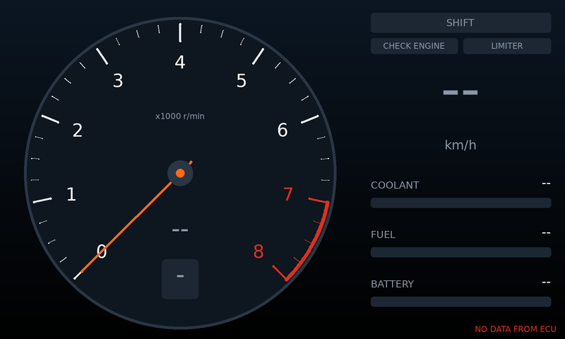

# MR2 Dashboard Firmware

Firmware for a custom STM32G0B1CBT6 board that drives a
[Newhaven NHD-7.0-800480FT-CSXP](https://newhavendisplay.com/) 7" 800×480 IPS
display and shows engine data from a [rusEFI](https://rusefi.com/) ECU
(uaEFI) over CAN. The display has an FT812 EVE graphics controller on board, so the MCU
sends compact display-list commands over SPI. The FT812 does the rendering;
there's no frame buffer on the MCU.


*Approximate preview, rendered on a PC from the firmware's real command stream
by `tools/render_preview.py`. The fonts are stand-ins for the EVE ROM fonts.*

## What it does

1. Brings up the clock (64 MHz from a crystal or HSI16), SysTick, SPI1, the
   debug UART and the CAN controller (FDCAN1, 500 kbit/s).
2. Resets and initialises the FT812 using the timing from the NHD datasheet.
3. Shows a splash screen, fades the backlight in and sweeps the tach needle.
4. Runs the gauge screen at about 60 fps: a tachometer with redline, a shift
   light, check-engine and limiter lamps, speed, gear, and
   coolant/fuel/battery bars, all from the ECU's CAN broadcast.
5. Sends a status frame back to the ECU 10 times a second (see
   [Dashboard → ECU](#dashboard--ecu)).

If the display stops responding (cable unplugged, co-processor fault), the
firmware logs it and re-initialises once a second. The CAN link keeps running
meanwhile. For bench work without an ECU, build with `-DMR2_DEMO_DATA=ON` to
show a built-in simulation instead (the screen then says "DEMO DATA").

## Hardware

| | |
|---|---|
| MCU | STM32G0B1CBT6: Cortex-M0+, 64 MHz, 128 KB flash, 144 KB RAM, LQFP48 |
| Display | NHD-7.0-800480FT-CSXP: FT812, 800×480, no touch panel |
| Display link | SPI mode 0. 8 MHz during init, 16 MHz after |
| ECU link | CAN 2.0, 500 kbit/s, via a 3.3 V transceiver (TJA1051T/3, SN65HVD230, MCP2562…) |

### Default pin map

> **Check these against your schematic.** The board is custom, so these are
> sensible defaults, not a known layout. All of them live in
> [`src/board/board.h`](src/board/board.h); change them there.

| Display pin (CN1/CN2) | Signal | STM32 pin | Notes |
|---|---|---|---|
| 1 VDD | 3.3 V | — | ~100 mA |
| 2, 19, 20 GND | GND | — | |
| 3 SCK | SPI clock | **PA5** | SPI1_SCK, AF0 |
| 4 MISO/IO1 | SPI MISO | **PA6** | SPI1_MISO, AF0 |
| 5 MOSI/IO0 | SPI MOSI | **PA7** | SPI1_MOSI, AF0 |
| 6 /CS | chip select | **PA4** | GPIO |
| 7 /INT | interrupt | **PB1** | GPIO input with pull-up (not used yet) |
| 8 /PD | power down | **PB0** | GPIO. Must be driven: the firmware resets the FT812 with it |
| 9 AUDIO_L | audio PWM | — | needs the datasheet's filter and amplifier |
| 17, 18 VBL | backlight supply | — | 3.3 V at ~760 mA, or 5 V at ~440 mA |

Other defaults:

| Function | Pin | Setting |
|---|---|---|
| CAN TX → transceiver TXD | **PB9** (FDCAN1_TX, AF3) | `CAN_TX_*` |
| CAN RX ← transceiver RXD | **PB8** (FDCAN1_RX, AF3) | `CAN_RX_*`, pull-up |
| Transceiver S/STBY/Rs | PB7 | `BOARD_HAS_CAN_STBY`, **off by default**: tie the pin low on the board, or enable this |
| Crystal | PF0 / PF1 | `BOARD_HSE_HZ`, **0 (none) by default** |
| Debug UART TX | **PA2** (USART2, AF1) | `BOARD_HAS_DEBUG_UART`, 115200 8N1 |
| Status LED | PB2 | `BOARD_HAS_STATUS_LED`, **off by default** |
| SWD | PA13 / PA14 | untouched |

**CAN wiring.** CANH/CANL go to the ECU's CAN pins (on uaEFI, the CAN pair
on the main connector). A CAN bus needs a 120 Ω terminator at each end. The
ECU usually has one; fit the other at the dash if it's the far end.

**Fit a crystal.** With this firmware's CAN bit timing (81.25 % sample point,
SJW 3), the dash's clock can be at most about 1.4 % off from the ECU's.
HSI16 is ±1 % at best and drifts further at temperature extremes, so it works
on the bench but leaves little margin in a car. Fit a crystal (8 MHz is
typical) on PF0/PF1 and set `BOARD_HSE_HZ` in `board.h`. If it doesn't start,
the firmware falls back to HSI16 and says so at boot.

The backlight at full brightness draws a lot of current. Make sure the VBL
supply can deliver it, or lower `BACKLIGHT_DUTY` in `src/main.c` (0–128) for
bench testing.

## Building

You need:

- the [Arm GNU toolchain](https://developer.arm.com/downloads/-/arm-gnu-toolchain-downloads)
  (`arm-none-eabi-gcc`, version 10 or later) on `PATH`. On Debian/Ubuntu:
  `sudo apt install gcc-arm-none-eabi libnewlib-arm-none-eabi`
- CMake 3.21 or later, and Ninja

```sh
cmake --preset release
cmake --build --preset release
# -> build/release/mr2-dashboard.{elf,hex,bin,map}
```

Use the `debug` preset (`build/debug/`) for an `-Og` build to step through.
Add `-DMR2_DEMO_DATA=ON` to the configure step to show simulated data instead
of the ECU's.
If the toolchain isn't on `PATH`, add `-DARM_TOOLCHAIN_DIR=/path/to/bin` to
the configure step. CMake 3.20 also works without presets:
`cmake -B build -G Ninja && cmake --build build`.

## Flashing

Any SWD probe works. For example:

```sh
# STM32CubeProgrammer
STM32_Programmer_CLI -c port=SWD -w build/release/mr2-dashboard.elf -v -rst

# OpenOCD with an ST-LINK. If OpenOCD was on PATH when you configured,
# this is also: cmake --build --preset release --target flash
openocd -f interface/stlink.cfg -f target/stm32g0x.cfg \
        -c "program build/release/mr2-dashboard.elf verify reset exit"
```

## Serial console

Connect a 3.3 V USB-UART to PA2 at 115200 8N1. `printf()` output goes there:

```
MR2 dashboard firmware 0.2.0
SYSCLK 64000000 Hz from crystal
CAN: 500 kbit/s, rusEFI broadcast at 0x200, dash status at 0x6D0
EVE: initialising
EVE: FT812 ready (chip id 0x00011208)
ECU: waiting for data at 0x200
ECU: receiving data
```

ECU link changes are logged as they happen, with the CAN error counters when
the data stops.

## ECU link (CAN)

The dash reads rusEFI's own CAN broadcast, "rusEFI CAN broadcast" in
TunerStudio (`can_verbose.cpp` in the rusEFI source, `rusEFI_CAN_verbose.dbc`
for CAN tools). uaEFI turns it on by default.

### ECU settings

In TunerStudio's CAN settings (uaEFI defaults shown):

| TunerStudio field | Value | Matching dash setting (`src/app/ecu_link.h`) |
|---|---|---|
| CAN read enabled, CAN write enabled | on | |
| Bitrate | 500 kbps | `ECU_CAN_BITRATE` |
| Enable rusEFI CAN broadcast | yes | |
| rusEFI CAN data bus | the bus the dash is wired to | |
| rusEFI CAN data base address | 512 (0x200) | `ECU_RUSEFI_BASE_ID` |
| rusEFI CAN data address type | 11 bit | `ECU_RUSEFI_EXT_ID` |
| rusEFI CAN data period | 50 ms | (`ECU_DATA_TIMEOUT_MS` must be well above this) |

For the gear indicator, set up gear detection on the ECU (gear count and
ratios, with a VSS). Without it rusEFI sends 0 and the dash shows N.

### What's shown

```
ECU --CAN--> FDCAN1 --interrupt--> receive queue (64 frames, timestamped)
    --ecu_link_poll()--> rusefi_data_t --ecu_link_get_dash()--> dash_data_t --> screen
```

| Screen | rusEFI message | Signal |
|---|---|---|
| Tach, rpm, shift light | base+1 | RPM |
| Speed | base+1 | VehicleSpeed |
| Gear | base+0 | CurrentGear |
| CHECK ENGINE lamp | base+0 | CELAct |
| LIMITER lamp | base+0 | RevLimAct: fuel or spark cut for any reason (rev limiter, launch control, limp mode…) |
| Coolant | base+3 | CoolantTemp |
| Fuel | base+3 | FuelLevel |
| Battery | base+4 | BattVolt |

All 12 broadcast messages are decoded (`src/app/rusefi_can.c`): MAP, IAT,
TPS/pedal, oil pressure and temperature, lambda, fuel pressure, trims, EGTs,
cams, knock and so on. They're available through `ecu_link_data()` for future
screens.

The ECU updates rpm 20 times a second and the screen redraws 60 times, so the
needle is low-pass filtered (`ECU_RPM_SMOOTH_MS`, 40 ms) to move smoothly.

**Stale data is never shown as live.** Each value expires 1 s
(`ECU_DATA_TIMEOUT_MS`) after its message last arrived. It's then drawn as
`--`, the needle drops to 0, and the bottom-right corner says why:

| Status line | Meaning |
|---|---|
| *(nothing)* | Receiving the ECU's broadcast |
| WAITING FOR ECU | Nothing received since power-up |
| NO DATA FROM ECU | The broadcast stopped |
| CAN BUS FAULT | The CAN controller is off the bus (it recovers by itself) or didn't start |
| DEMO DATA | Built with `MR2_DEMO_DATA` |



### Dashboard → ECU

The dash sends an 8-byte status frame on ID **0x6D0** (`DASH_TX_ID`) every
100 ms, and straight away when an input or the mode changes:

| Byte | Content |
|---|---|
| 0 | Counter, +1 per frame |
| 1 | Flags: bit 0 display running, bit 1 dash is receiving ECU data |
| 2–3 | Inputs, little-endian: bit *n* = input *n* active (`ecu_link_set_inputs()`) |
| 4 | Mode (`ecu_link_set_mode()`) |
| 5–7 | 0, reserved |

rusEFI hands frames like this to its Lua engine.
[`tools/rusefi/dash_link.lua`](tools/rusefi/dash_link.lua) is a ready-made ECU
script. It receives the frame, releases all inputs if the dash goes quiet for
0.5 s, and publishes inputs, mode and "dash alive" on Lua gauges 1–3 for
TunerStudio. Put your own actions in its `onDashInputs()`.

Nothing on the board drives the inputs yet. Wire buttons to spare GPIOs and
call `ecu_link_set_inputs()` from the main loop. Set `DASH_TX_ENABLE` to 0 for
a receive-only dash.

## Bring-up checklist

| Symptom | Things to check |
|---|---|
| `EVE: no response (REG_ID != 0x7C)` | 3.3 V on VDD; /PD wired and toggling; SCK/MOSI/MISO/CS on the right pins; MISO not swapped with MOSI; cable length (lower `EVE_SPI_PRESC_INIT` to `SPI_PRESC_DIV16`) |
| `ready`, but the screen stays dark | VBL supply present and strong enough; `BACKLIGHT_DUTY` > 0 |
| Backlight on, but no picture or noise | Panel timing in `src/eve/eve_panels.c`; try `cspread = 1` |
| Random `co-processor fault` / timeouts | Signal integrity at 16 MHz: try `EVE_SPI_PRESC_RUN = SPI_PRESC_DIV8`, shorten the cable, add a ground wire next to SCK |
| No UART output | `BOARD_HAS_DEBUG_UART`, TX pin, and baud rate. The firmware still runs without it |
| `WAITING FOR ECU` forever | ECU broadcast enabled, base address 0x200, 11-bit; same bit rate both ends; CANH/CANL not swapped; transceiver powered and its S/STBY pin low; TX/RX not swapped at the MCU |
| `NO DATA FROM ECU` with TEC/REC climbing in the log | Bit-rate or clock mismatch: fit a crystal (`BOARD_HSE_HZ`); check termination (about 60 Ω between CANH and CANL with the power off) |
| `CAN BUS FAULT` | Bus shorted, or the dash is alone on a bus at the wrong bit rate. It retries every 100 ms |

## Tests and preview

The EVE driver, the CAN pipeline, the renderer and the simulation are covered
by host tests that run on a PC against a simulated FT812 and a mock CAN
driver. The FT812 simulation decodes the SPI frames the way the chip does.
The tests check:

- the power-up sequence and its timing
- SPI framing
- the register values from the datasheet
- command-FIFO chunking and fault recovery
- every rendered frame: well-formed, on-screen, and small enough for the 8 KB display list
- the rusEFI decoder, against frames built from the signal definitions in
  rusEFI's DBC file (not from the decoder's own byte offsets)
- the pipeline: value mapping, expiry, link states, frames queued past their
  timeout, rpm smoothing
- the dash status frame: layout, timing, behaviour when nobody acknowledges it
- the receive queue across index wrap-around

`tools/rusefi/dash_link.lua` can be checked with Lua 5.4 (`luac5.4 -p`).

```sh
cmake -S tests -B build-tests -G Ninja
cmake --build build-tests
ctest --test-dir build-tests --output-on-failure
```

To preview screen changes without hardware (needs Python 3 and Pillow):

```sh
./build-tests/preview_dump build-tests
tools/render_preview.py build-tests/*.bin   # -> build-tests/*.png
```

CI (`.github/workflows/ci.yml`) builds both firmware configurations with
`-Werror` and runs the host tests.

## Project layout

```
src/
  main.c                boot sequence and main loop
  board/                STM32G0B1 support: pins (board.h), clock, GPIO, SysTick, SPI, UART, syscalls
  eve/
    ft81x.h             FT81x registers and commands (names as in the Programmers Guide)
    eve.c/.h            EVE driver: init, memory access, command FIFO, widgets
    eve_hal.h           hardware interface the driver needs (SPI, CS, /PD, time)
    eve_hal_stm32.c     ... implemented for this board
    eve_panels.c        display timing for the NHD-7.0-800480FT-CSXP
  can/
    can.h               CAN driver interface (frames, filters, stats)
    can_queue.h         interrupt -> main loop frame queue
    can_stm32.c         FDCAN driver: filters, receive interrupt, TX FIFO, bus-off recovery
  app/
    dashboard.c         screen layout and drawing
    dash_data.h         what the screen shows, with validity and link state
    ecu_link.c/.h       CAN pipeline: ECU data -> dash values, dash status -> ECU; its settings
    rusefi_can.c/.h     rusEFI broadcast decoder (all 12 messages)
    demo_data.c         simulated engine data
    fixmath.c           integer sin/cos for the gauge geometry
linker/                 STM32G0B1CBTx linker script
third_party/            CMSIS core 5.9.0 and ST cmsis_device_g0 v1.4.5 (Apache-2.0)
tests/                  host tests, mock FT812, mock CAN driver, preview dumper
tools/render_preview.py approximate PNG renderer for command streams
tools/rusefi/           ECU-side Lua script for the dash status frame
```

## Notes and next steps

- **More from the ECU.** Everything rusEFI broadcasts is decoded already
  (`ecu_link_data()`). Oil pressure, AFR and boost are a matter of screen
  space.
- **Dash inputs.** The status frame carries 16 inputs and a mode byte to the
  ECU, but no buttons are wired yet.
- **Throughput.** The SPI driver is polled. A frame is about 1.5 KB, roughly
  1 ms at 16 MHz, so DMA is a later optimisation and not needed yet.
- **Not used yet.** Touch (this module has no panel fitted, so the touch
  engine is switched off), audio (AUDIO_L needs the datasheet's filter and
  amplifier circuit), /INT, the EVE GPIOs, and dual/quad SPI.
- **References.** The FT81x Series Programmers Guide documents every register
  and command in `ft81x.h`. The NHD datasheet gives the panel timing and the
  backlight PWM range (800 Hz–10 kHz).
